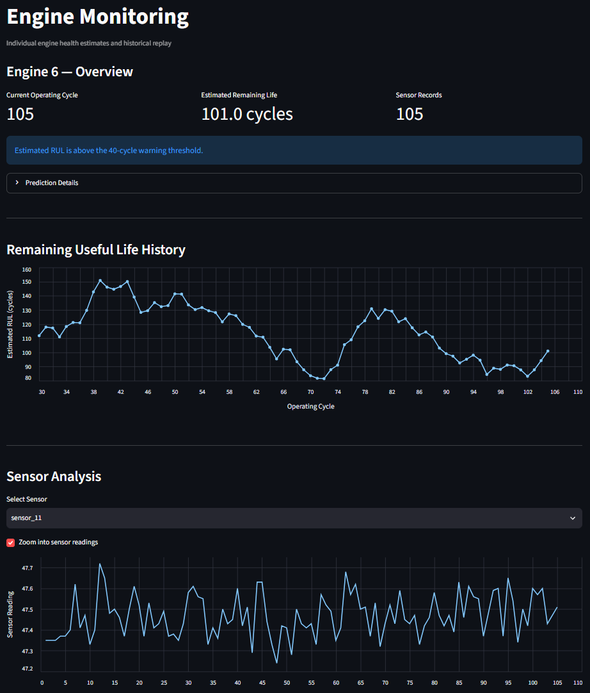
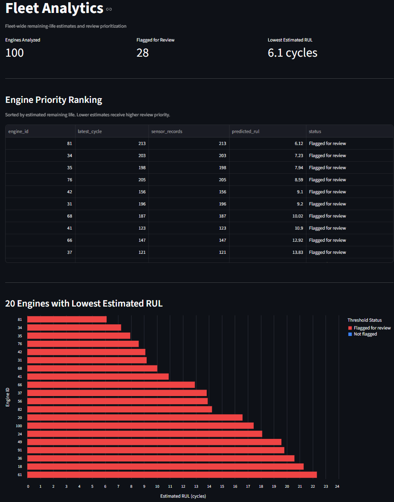
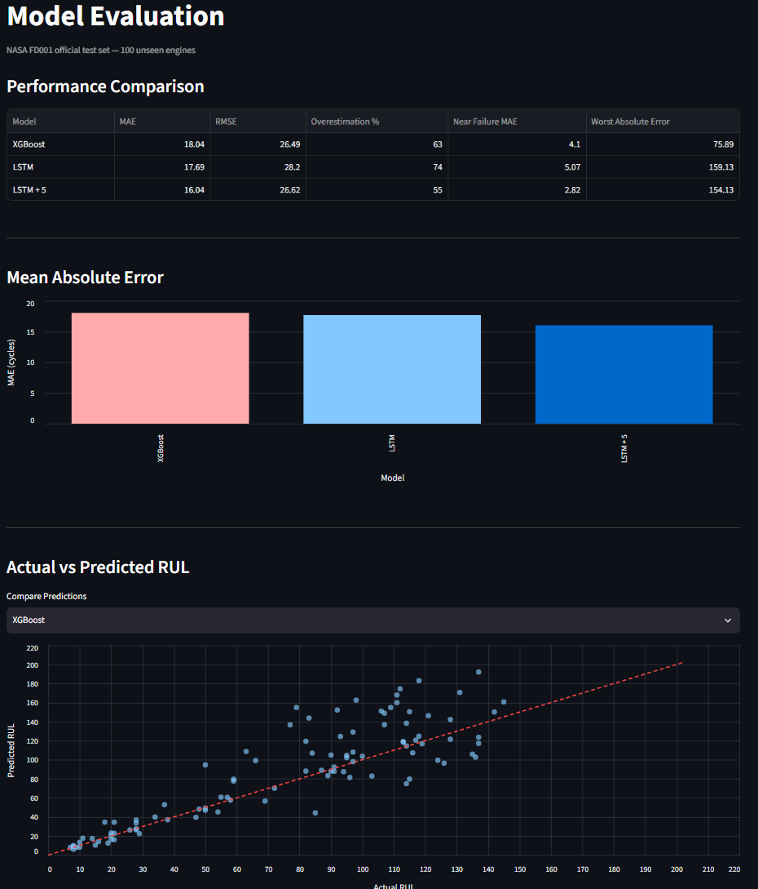

# Predictive Maintenance AI — Turbofan Remaining Useful Life

A machine-learning prototype that estimates **remaining useful life (RUL)** in operating cycles from turbofan-engine sensor history. It combines a feature-based **XGBoost** model, a sequence-based **PyTorch LSTM**, and a **Streamlit** application for individual-engine monitoring, historical replay, fleet ranking, and model evaluation.

> **Research/demo use only.** The data comes from a simulation, and model predictions can be substantially wrong. This application is **not** suitable for real maintenance or safety decisions.


## Dashboard Preview

### Engine Monitoring
Interactive engine monitoring with remaining useful life
predictions, historical replay, and sensor trends.



### Fleet Analytics
Fleet-wide predictive maintenance with engine prioritization,
configurable warning thresholds, and CSV exports.



### Model Evaluation
Comparison of XGBoost and LSTM models on NASA C-MAPSS FD001,
including prediction errors and model limitations.




## What it does

- **Engine monitoring:** Select an engine or upload a compatible CSV to estimate its remaining operating cycles.
- **Historical replay:** Move through an engine's recorded cycles and see how the estimated RUL changes as readings become available.
- **Sensor exploration:** Plot sensor histories and inspect recent measurements.
- **Fleet analytics:** Rank engines by predicted RUL, flag estimates crossing a configurable *demonstration* threshold, and export results as CSV.
- **Model evaluation:** Compare XGBoost, unadjusted LSTM, and LSTM with a five-cycle conservative adjustment on NASA's test-engine endpoints.

The dashboard uses an **LSTM with a five-cycle downward adjustment** for its main RUL estimates. This adjustment is an experimental, validation-selected choice—not a calibrated uncertainty bound or a certified safety margin.

## Dataset

**NASA C-MAPSS — Turbofan Engine Degradation Simulation, FD001**

- 100 training engines, with histories running to their simulated failure endpoints (**20,631 rows**).
- 100 test engines, with histories truncated before failure (**13,096 rows**); true remaining-life values are supplied separately.
- Each measurement row has an engine ID, operating cycle, three operational settings, and **21 sensor channels**.
- FD001 represents a single operating condition and a high-pressure-compressor degradation mechanism.
- RUL is measured in **operating cycles**, not hours, days, or calendar time.

Dataset download: [NASA C-MAPSS ZIP](https://data.nasa.gov/docs/legacy/CMAPSSData.zip). The automated setup script downloads and processes FD001; raw data is not committed to the repository.

## Approach

### 1. Labeling and splitting

For each training engine, the supervised target is:

`RUL at cycle t = engine's final recorded cycle − t`

The original 100 training engines are divided into **80 training engines / 20 validation engines**, using a fixed random seed (`42`). Splitting by entire engine prevents histories from the same engine leaking across sets. NASA's 100 separate test engines are used for endpoint evaluation.

### 2. XGBoost

Six constant sensors are excluded based on training data. For each of the remaining **15 channels**, the model receives its latest reading, 30-cycle mean, 30-cycle standard deviation, and change over 30 cycles. Combined with the current cycle number, that produces **61 model inputs** (60 engineered sensor features + cycle number).

### 3. LSTM

The LSTM receives the **most recent 30 consecutive cycles × 15 selected sensor channels**. Sensors are standardized using statistics fit only on the training engines. The architecture uses a two-layer LSTM (hidden size 64, dropout 0.2) followed by a small regression head. Inference runs on CPU.

The LSTM sees the measured sequence; unlike XGBoost, this version does **not** receive the cycle number as an explicit input feature.

## Evaluation results

Measured at **one final observed point for each of the 100 official FD001 test engines**:

| Model | MAE ↓ (cycles) | RMSE ↓ (cycles) | Overestimates | Near-failure MAE ↓ (cycles) |
|---|---:|---:|---:|---:|
| XGBoost | 18.04 | **26.49** | 63% | 4.10 |
| LSTM | 17.69 | 28.20 | 74% | 5.07 |
| **LSTM − 5 cycles** | **16.04** | 26.62 | **55%** | **2.82** |

Here, *near failure* means the engine's true RUL is **30 cycles or less** (25 test engines). The downward adjustment changes the estimate to `max(0, raw LSTM prediction − 5)`.

**Important limitations:**

- The buffered LSTM's **worst absolute test error was 154.13 cycles**; **17 of 100 engines** had errors larger than 30 cycles.
- On some engines, the model substantially **overestimates** time remaining.
- Independent per-window predictions can fluctuate upward, even as an engine ages.
- The five-cycle adjustment was selected using validation results; because test results were later inspected during model selection, the displayed test scores should be read as **descriptive**, not a pristine model-selection benchmark.
- Historical validation scores calculated over every eligible cycle are **not directly comparable** with the one-endpoint-per-engine official test scores.
- These results apply to the **FD001 simulation**, not other engines, factories, or sensor systems without new data and validation.

## Run locally

**Requirements:** Python 3.12 (tested during development), `pip`, and an internet connection for the initial NASA dataset download. A GPU is **not required** to run inference.

### 1. Install dependencies

```bash
python -m venv .venv
```

On Windows PowerShell:

```powershell
.\.venv\Scripts\Activate.ps1
python -m pip install -r requirements.txt
```

On macOS/Linux:

```bash
source .venv/bin/activate
python -m pip install -r requirements.txt
```

### 2. Prepare the NASA data

```bash
python scripts/setup_data.py
```

The setup script downloads/extracts FD001 if required, generates training RUL labels, recreates the deterministic engine split and engineered features, and saves test endpoints and an example upload CSV.

### 3. Launch the dashboard

```bash
python -m streamlit run app.py
```

Open the local URL printed by Streamlit (normally `http://localhost:8501`). Select **Engine Monitor**, **Fleet Analytics**, or **Model Evaluation** in the sidebar.

### 4. Try command-line inference

```bash
python src/predict.py --engine-id 25
```

The saved model is used for inference; no training is needed to run this command.

### 5. Run automated checks

```bash
python -m pytest tests/ -v
```

The tests check checkpoint loading, individual predictions, history replay, fleet agreement, and rejection of insufficient or discontinuous histories. They are software smoke tests, not evidence of safety or generalization.

## CSV input format

Upload a **headered CSV** with the following columns:

- `engine_id`, `cycle`
- `setting_1`, `setting_2`, `setting_3`
- `sensor_1` through `sensor_21`

Each engine must have at least **30 consecutive cycles**. IDs and cycle numbers must be positive integers; readings must be numeric and finite. The interface accepts multiple engines in the same CSV.

For a ready-to-use example, upload `data/processed/engine_25_demo.csv` after running data setup.

> Matching the column names does **not** make real-world sensor data compatible. Units, distributions, operating conditions, and failure mechanisms must also align with the training domain.

## Project structure

```text
Predictive-Maintenance/
├── app.py                          # Streamlit UI
├── src/
│   ├── predict.py                  # LSTM checkpoint loading and inference
│   └── fleet.py                    # Batched fleet predictions
├── scripts/
│   └── setup_data.py               # Dataset download and preprocessing
├── tests/
│   └── test_inference.py           # Inference smoke tests
├── notebooks/                      # EDA, feature engineering, training, evaluation
├── models/
│   ├── lstm_fd001.pt               # Saved LSTM + preprocessing stats
│   ├── xgboost_fd001.json          # Saved XGBoost model
│   └── xgboost_features.json       # XGBoost feature names/order
├── data/
│   ├── raw/                        # Downloaded NASA data (Git-ignored)
│   └── processed/                  # Generated data and selected evaluation CSVs
├── requirements.txt
├── requirements-lock.txt
└── .gitignore
```

The notebooks document model experimentation. The dataset setup and saved checkpoints enable repeatable **data preparation and inference**, but the repository does not currently promise bit-for-bit identical retraining across machines.

## Tech stack

Python · pandas · NumPy · scikit-learn · XGBoost · PyTorch · Streamlit · Altair · Matplotlib · pytest

## Future extensions

- Evaluate decision policies with costs for late versus early maintenance alerts.
- Estimate **calibrated prediction intervals** rather than displaying only a point estimate.
- Assess other C-MAPSS subsets with varying operating conditions.
- Add shift/drift detection before accepting unfamiliar sensor inputs.

---

**Disclaimer:** This is a portfolio/research demonstration built on simulated data. It does not diagnose failures, certify engine health, or replace inspection and maintenance procedures.
